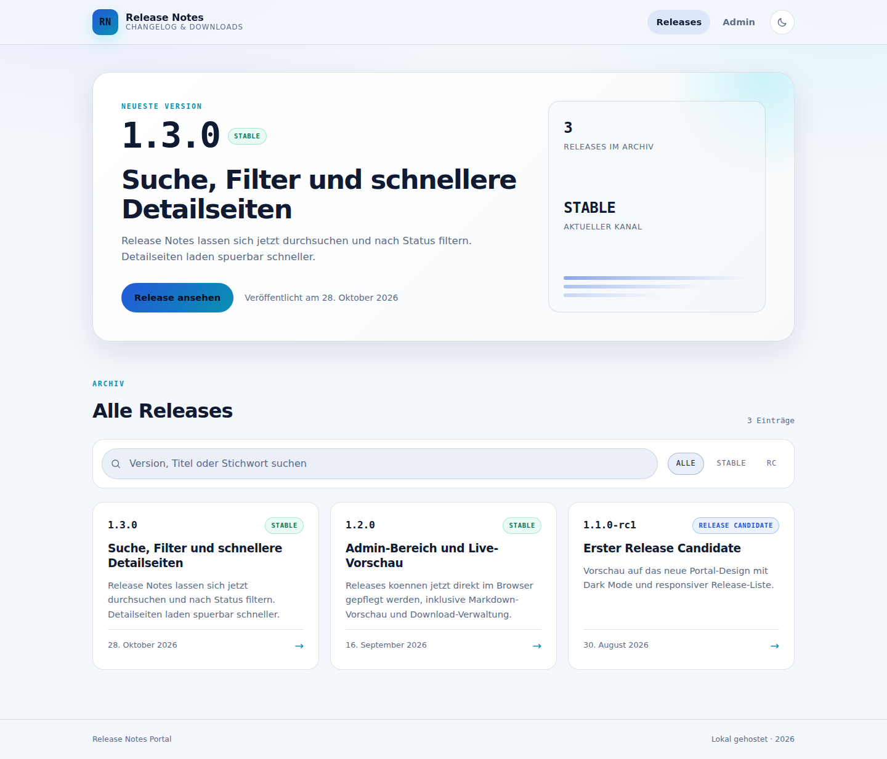

# ReleaseNotes Portal

Lokales, selbst gehostetes Release-Notes-Portal fuer Proxmox VE. Laeuft in einem
eigenen LXC, speichert alles in SQLite und braucht keine Cloud, keinen externen
Dienst und keine Registrierung.



## Funktionen

- Oeffentliche Release-Liste mit Suche und Statusfilter (`stable`, `beta`, `rc`)
- Release-Detailseite mit Markdown, Downloads und bekannten Problemen
- Admin-Bereich mit Login: anlegen, bearbeiten, veroeffentlichen, loeschen
- Export aller Releases als JSON
- Dark-/Light-Theme, responsive Oberflaeche, deutsche UI
- Healthcheck unter `/healthz`, SQLite-Backup durch Dateikopie
- Keine Telemetrie, keine externen Requests im Betrieb

## Installation

Auf einem Proxmox-VE-Host als `root`:

```bash
bash -c "$(curl -fsSL https://raw.githubusercontent.com/HatchetMan111/FireNexWall-Proxmox/main/install/releasenotes.sh)"
```

Alternativ mit `wget`:

```bash
bash -c "$(wget -qLO - https://raw.githubusercontent.com/HatchetMan111/FireNexWall-Proxmox/main/install/releasenotes.sh)"
```

Der Installer:

1. ermittelt die naechste freie CT-ID,
2. laedt bei Bedarf das Debian-12-Template,
3. erstellt einen unprivilegierten LXC mit 2 vCPU, 2048 MB RAM, 8 GB Disk,
   `onboot 1` und DHCP,
4. installiert Node.js, Python, SQLite und die App,
5. baut das Frontend, initialisiert die Datenbank und startet
   `releasenotes.service`,
6. beschraenkt Port `8080` und SSH per ufw auf RFC1918-Netze,
7. prueft `/healthz` und zeigt URL, Zugangsdaten und CT-ID an.

Am Ende erscheint eine Ausgabe wie:

```text
  ReleaseNotes ist installiert.

  Web-UI:      http://192.168.1.50:8080
  Admin:       http://192.168.1.50:8080/admin
  Benutzer:    admin
  Admin-Passwort: <zufaellig erzeugt>
```

Das Admin-Passwort wird nur bei der Erstinstallation erzeugt und angezeigt.
Es landet nicht im Installationslog: Die Ausgabe geht direkt an das Terminal.
Ohne Terminal (z. B. Automatisierung) wird es nach
`/root/releasenotes-admin-password` geschrieben (`0600`).

### Nicht-interaktiv

```bash
bash -c "$(curl -fsSL https://raw.githubusercontent.com/HatchetMan111/FireNexWall-Proxmox/main/install/releasenotes.sh)" -- --yes
```

### Optionen

| Option | Bedeutung | Default |
| --- | --- | --- |
| `--ctid ID` | Container-ID | naechste freie ID |
| `--hostname NAME` | CT-Hostname | `releasenotes` |
| `--cores N` | vCPUs | `2` |
| `--ram MB` | RAM in MiB | `2048` |
| `--disk GB` | Disk in GiB | `8` |
| `--storage NAME` | Storage fuer die Disk | automatisch |
| `--template-storage NAME` | Storage fuer das Template | `local` |
| `--bridge NAME` | Linux-Bridge | `vmbr0` |
| `--port N` | Web-Port | `8080` |
| `--admin-password PW` | Admin-Passwort setzen | zufaellig |
| `--repo URL` | Git-Repo | dieses Repo |
| `--ref REF` | Branch/Tag | `main` |
| `--force` | fremden CT mit dieser ID entfernen | aus |
| `--yes` | nicht-interaktiv | aus |
| `--debug` | `bash -x` und mehr Diagnose | aus |

Beispiel mit fester ID und eigenem Port:

```bash
bash -c "$(curl -fsSL https://raw.githubusercontent.com/HatchetMan111/FireNexWall-Proxmox/main/install/releasenotes.sh)" -- --ctid 120 --port 8090
```

## Nach der Installation

| Zweck | Befehl |
| --- | --- |
| Logs | `pct exec <CTID> -- journalctl -u releasenotes -f` |
| Shell | `pct enter <CTID>` |
| Neustart | `pct reboot <CTID>` |
| Stoppen | `pct stop <CTID>` |
| Entfernen | `pct stop <CTID> && pct destroy <CTID> --purge` |
| Installationslog | `pct exec <CTID> -- less /var/log/releasenotes-install.log` |

### Update

Der Installer erkennt einen vorhandenen Container mit Hostname `releasenotes`
und aktualisiert die App, ohne Datenbank, Secret oder Admin-Passwort zu
ersetzen:

```bash
bash -c "$(curl -fsSL https://raw.githubusercontent.com/HatchetMan111/FireNexWall-Proxmox/main/install/releasenotes.sh)" -- --ctid <CTID>
```

### Admin-Passwort zuruecksetzen

```bash
bash -c "$(curl -fsSL https://raw.githubusercontent.com/HatchetMan111/FireNexWall-Proxmox/main/install/releasenotes.sh)" -- --ctid <CTID> --admin-password 'neues-passwort'
```

### Backup und Restore

Alle Daten liegen in einer SQLite-Datei:

```bash
pct exec <CTID> -- systemctl stop releasenotes
pct pull <CTID> /var/lib/releasenotes/releasenotes.db ./releasenotes.db
pct exec <CTID> -- systemctl start releasenotes
```

Restore: Datei nach `/var/lib/releasenotes/releasenotes.db` kopieren, Rechte
auf `releasenotes:releasenotes` setzen, Dienst starten.

## Architektur

```text
Browser
  |
  v
FastAPI (uvicorn, 0.0.0.0:8080)  --->  SQLite /var/lib/releasenotes/releasenotes.db
  |                                          |
  +--> React-SPA aus /opt/releasenotes/web/dist
```

- **Backend:** FastAPI, SQLite (WAL), scrypt-Passworthash, HMAC-signiertes
  Session-Cookie, Login-Rate-Limit, Origin-Pruefung bei Schreibzugriffen.
- **Frontend:** React 18, TypeScript, Vite, React Router, react-markdown.
- **Betrieb:** systemd mit `Restart=always`, `onboot 1`, keine Root-Rechte,
  `ProtectSystem=strict`, `NoNewPrivileges=true`.
- **Konfiguration:** `/etc/releasenotes/config.env` (`0600`, root). Der Dienst
  liest sie ueber systemd, der App-Benutzer kann sie nicht lesen.

### API

| Methode | Pfad | Auth | Zweck |
| --- | --- | --- | --- |
| `GET` | `/healthz` | nein | Healthcheck |
| `GET` | `/api/releases` | nein | veroeffentlichte Releases |
| `GET` | `/api/releases/{slug}` | nein | Release-Detail |
| `GET` | `/api/latest` | nein | neuestes stabiles Release |
| `GET` | `/api/session` | nein | Login-Status |
| `POST` | `/api/login` | nein | Login |
| `POST` | `/api/logout` | Cookie | Logout |
| `GET` | `/api/admin/releases` | Cookie | alle Releases |
| `POST` | `/api/admin/releases` | Cookie | Release anlegen |
| `PUT` | `/api/admin/releases/{id}` | Cookie | Release bearbeiten |
| `DELETE` | `/api/admin/releases/{id}` | Cookie | Release loeschen |
| `GET` | `/api/admin/export` | Cookie | JSON-Export |

## Entwicklung

Voraussetzungen: Python 3.12, Node.js >= 18, npm.

```bash
# Backend
cd app
python3 -m venv .venv
.venv/bin/pip install -r requirements.txt -r requirements-dev.txt
PYTHONPATH=. .venv/bin/pytest -v

# Frontend
cd web
npm ci
npm run build
```

Lokal starten (Seed-Daten, temporaere DB):

```bash
cd app
RELEASENOTES_DB=/tmp/releasenotes.db \
RELEASENOTES_STATIC=../web/dist \
RELEASENOTES_SEED=../data/seed.json \
RELEASENOTES_SECRET=dev-secret \
RELEASENOTES_ADMIN_HASH="$(PYTHONPATH=. .venv/bin/python -c 'from releasenotes.auth import hash_password; print(hash_password("admin"))')" \
.venv/bin/uvicorn releasenotes.main:app --reload --port 8080
```

Die Datenbank wird beim ersten Start aus `data/seed.json` befuellt. Die
Seed-Inhalte sind Beispieldaten und keine echten Release-Notes eines
Unternehmens.

## Tests

```bash
bash tests/static-checks.sh   # bash -n, shellcheck, Strukturpruefungen
bash tests/api.sh             # Backend-Tests
bash tests/local-smoke.sh     # startet die App lokal und prueft Login/CRUD
```

Auf einem Proxmox-Host nach der Installation:

```bash
bash tests/reboot-test.sh --ctid <CTID> --port 8080
```

Der Reboot-Test prueft Dienst und `/healthz` vor und nach `pct reboot`, wartet
auf eine neue `boot_id` und schreibt die Evidenz nach
`docs/test-evidence.md`.

Die CI (`.github/workflows/ci.yml`) fuehrt Backend-Tests, Frontend-Build,
Shellcheck und den lokalen Smoke-Test bei jedem Push aus. Ein echter
Proxmox-Installations- und Reboot-Test ist in GitHub Actions nicht moeglich und
muss auf einem Host erfolgen.

## Fehlerbehebung

| Problem | Loesung |
| --- | --- |
| `pct`/`pvesh` nicht gefunden | Auf dem Proxmox-Host ausfuehren, nicht im CT |
| Kein Debian-12-Template | `pveam update && pveam available --section system` pruefen |
| `git clone` schlaegt fehl | Repo muss oeffentlich erreichbar sein; `--repo`/`--ref` pruefen |
| Web-UI nicht erreichbar | `pct exec <CTID> -- systemctl status releasenotes` und Journal pruefen |
| Admin-Passwort vergessen | Installer mit `--admin-password` erneut ausfuehren |
| Port belegt | `--port` bei Installation und Update gleich setzen |
| Update bricht ab | `--debug` nutzen; vollstaendige Fehlerkette und Logs werden ausgegeben |

Installations- und Fehlerlogs:

```bash
pct exec <CTID> -- tail -n 100 /var/log/releasenotes-install.log
pct exec <CTID> -- journalctl -u releasenotes -n 100 --no-pager
```

## Sicherheit

- Admin-Passwort als scrypt-Hash, niemals im Klartext in der Datenbank.
- Session-Cookie `HttpOnly`, `SameSite=Lax`, HMAC-signiert, 12 Stunden gueltig.
- Login-Limit: 5 Fehlversuche pro 300 Sekunden und IP.
- Schreibende API-Aufrufe pruefen den `Origin`-Header.
- LXC ist unprivilegiert; Dienst laeuft als eigener Systembenutzer.
- ufw erlaubt Port `8080` und SSH nur aus `10/8`, `172.16/12`, `192.168/16`.
- Fuer Zugriff ausserhalb des LANs: Reverse Proxy mit TLS und Authentifizierung
  davorsetzen; `RELEASENOTES_COOKIE_SECURE=1` setzen.

## Projektstruktur

```text
install/releasenotes.sh          Host-Installer (Proxmox)
install/releasenotes-inner.sh    Container-Installer
app/releasenotes/                FastAPI-App
app/tests/                       pytest-Suite
web/                             React-Frontend
data/seed.json                   Beispieldaten
systemd/releasenotes.service     Unit-Template
tests/                           Statische Checks, API-, Smoke-, Reboot-Test
docs/                            Spec, Plan, Screenshots, Testevidenz
```

## Lizenz

Noch nicht festgelegt. Vor einer oeffentlichen Veroeffentlichung entscheiden.
